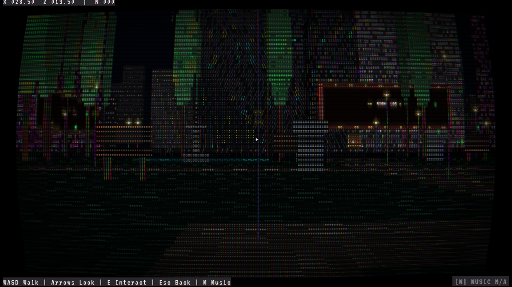
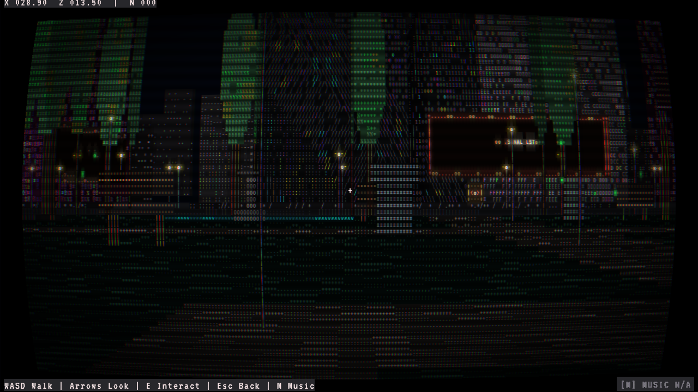
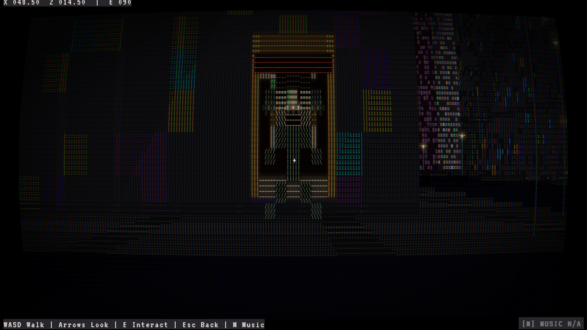
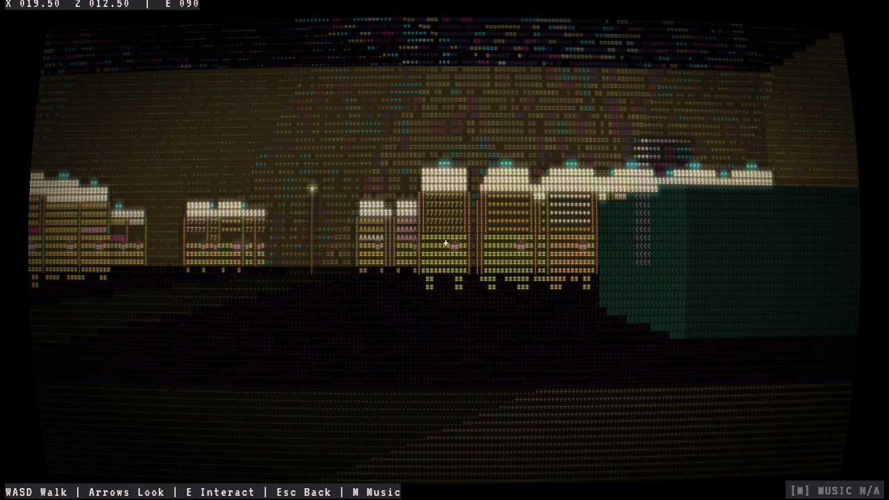
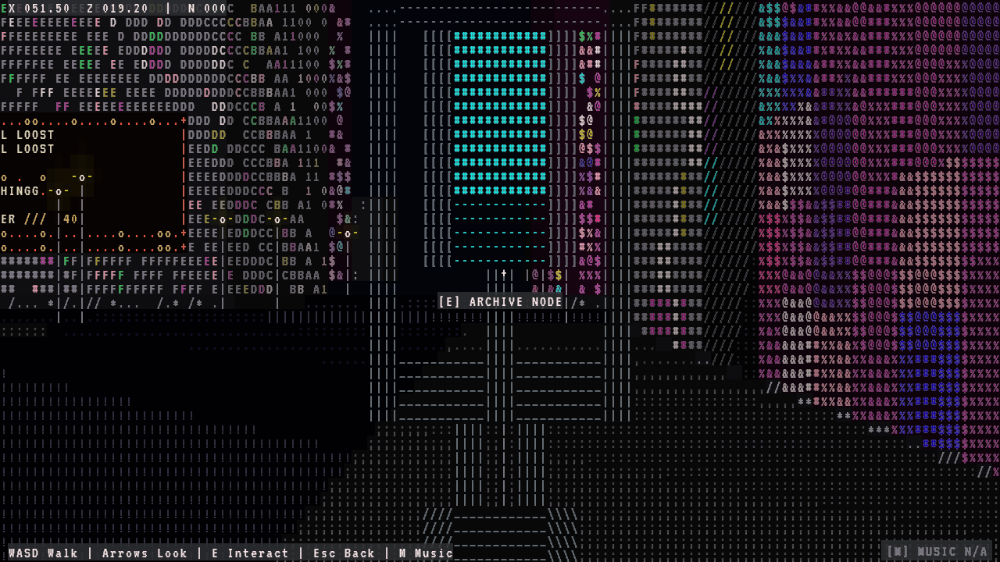
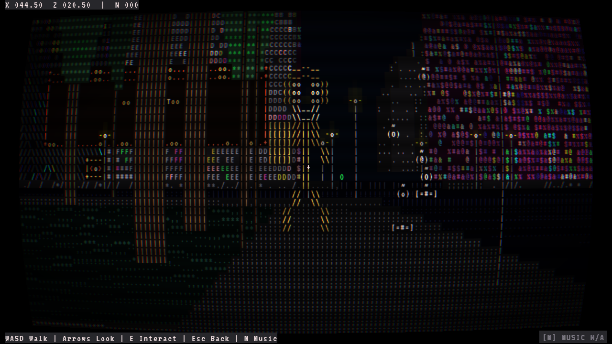

<p align="center">
  
</p>

<h1 align="center">ASCII City</h1>

<p align="center">
  <strong>FIRST-PERSON ASCII CYBERPUNK STORY GAME</strong><br />
  Walk the city, meet its people, and uncover what lies beneath its network.
</p>

<p align="center">
  Kotlin &middot; LibGDX &middot; LWJGL3 &middot; CPU-rendered ASCII perspective
</p>

ASCII City is a desktop exploration game built from authored maps and a first-person ASCII renderer. The city foundation is playable. The planned Kernel-Panic campaign is still being adapted from the documents in [`storyline-docs/`](storyline-docs/README.md).

## Current state

You can walk through four authored maps, inspect the environment, interact with terminals and characters, and hear the city change between its districts. The old `Last Packet` story is a prototype. The Kernel-Panic campaign, its choices, and its persistent story progress are not implemented yet.

The campaign documents describe a novice hacker caught in a conflict involving the Architect, the Oracle, and a mysterious system component. The story builds through several arcs, faction relationships, player choices, and multiple endings. The [`campaign roadmap`](storyline-docs/CAMPAIGN_WIP/MASTER_CAMPAIGN_ROADMAP.md) and [`story analysis`](storyline-docs/CAMPAIGN_WIP/STORY_ANALYSIS.md) hold the details.

## In the game now

- First-person movement, turning, and vertical look.
- Four authored maps: `city-alpha`, `water-park`, `nature-reserve`, and `casino`.
- Semantic collision for buildings, water, park fixtures, doors, and characters.
- Perspective ASCII rendering with fog, rain, animated facades, street lamps, and depth-tested sprites.
- Center-screen prompts, terminal responses, and linear dialogue.
- Ambient traffic, steam, rooftop exhaust, small street events, and scheduled pedestrians. Traffic cars are scenery; the player cannot drive them.
- City and park music, rain, footsteps, and optional head bob.
- A responsive desktop window with Fine 6×12 ASCII as the default world profile.

## Screenshots

| City street | Archive district | Casino |
|---|---|---|
|  |  |  |





## Run

Requirements:

- The checked-in Gradle wrapper.
- Internet access on the first build so Gradle can resolve dependencies and provision the pinned Java 21 toolchain.

Launch the game:

```powershell
./gradlew gameRun
```

The desktop window starts at a 1280×720 logical size and keeps that as its minimum. Larger windows expand the view with whole-number glyph scaling.

Choose a world font profile:

```powershell
./gradlew desktop:run --args="--ascii-density=fine"
./gradlew desktop:run --args="--ascii-density=dense"
./gradlew desktop:run --args="--ascii-density=standard"
```

See [run commands](DOCS/run-cmd.md) for screenshots, map selection, camera options, and verification routes.

## Controls

| Input | Action |
|---|---|
| `W` / `S` | Walk forward or backward |
| `A` / `D` | Strafe |
| Left / Right arrows | Turn |
| Up / Down arrows | Look up or down |
| `E` or Enter | Interact or advance dialogue |
| Escape | Cancel or close dialogue |
| `F3` | Show diagnostics and the debug footprint |
| `Tab` while F3 is open | Load the next playable map |
| `C` while F3 is open | Toggle the CRT effect |
| `M` or the music HUD button | Mute or unmute city and park music |

Rain and footsteps keep playing when music is muted.

## Build and verify

```powershell
./gradlew clean check
./gradlew :core:validateContent
```

Useful desktop checks:

```powershell
./gradlew desktop:run --args=--smoke-test
./gradlew desktop:run --args=--verify-walk
./gradlew desktop:run --args=--verify-interaction
./gradlew desktop:run --args=--verify-presentation
```

The [`verification notes`](DOCS/verification-notes.md) record test and runtime evidence.

## Project layout

- `core/`: gameplay, simulation, content loading, rendering, input, and UI.
- `desktop/`: LWJGL3 launcher and desktop window configuration.
- `assets/data/`: palette, presentation, materials, cells, sprites, and dialogue.
- `assets/maps/`: map footprints, metadata, and authored objects.
- `storyline-docs/`: campaign structure, lore, mission guides, and story analysis.
- `DOCS/`: map and rendering contracts, authoring guides, verification notes, and implementation plans.

Start with the [map authoring guide](DOCS/map-authoring-guide.md), [map format](DOCS/map-format.md), or [rendering contract](DOCS/rendering-contract.md) when changing the world.

## Architecture

`GameScreen` owns the LibGDX screen lifecycle. `PlayerSimulation`, movement, look, collision, and `GameWorld` own gameplay state. `ContentLoader` validates maps and dialogue before world construction. `WorldAsciiRenderer` builds the first-person frame, and `AsciiPresenter` draws it without changing collision or authored content.

The project uses a small Kotlin domain model. It does not use a general ECS or a 3D model pipeline.

The [development plan](DOCS/devplans/ascii-city-development-plan.md) records the existing engine work and the shift from the `Last Packet` prototype to the campaign docs.

## Technology

- Kotlin/JVM
- LibGDX
- LWJGL3 desktop backend
- Gradle Kotlin DSL
- CPU-rendered ASCII perspective
